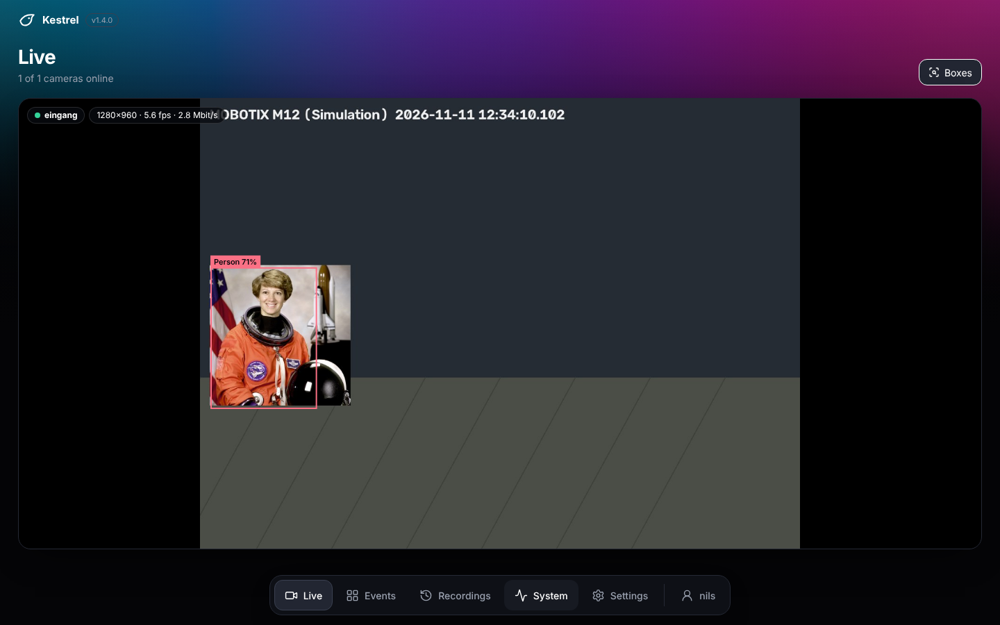
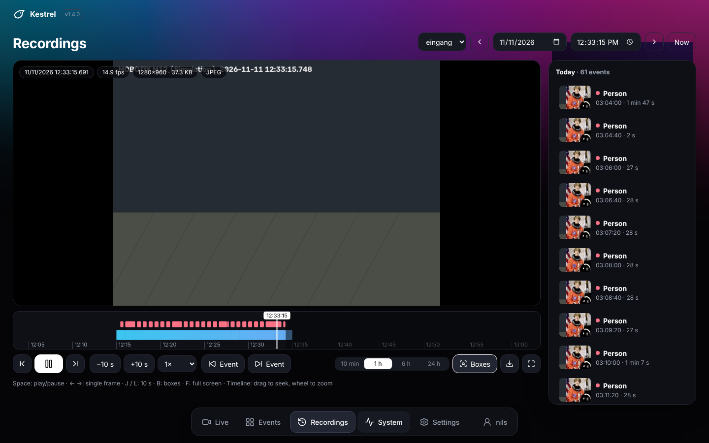
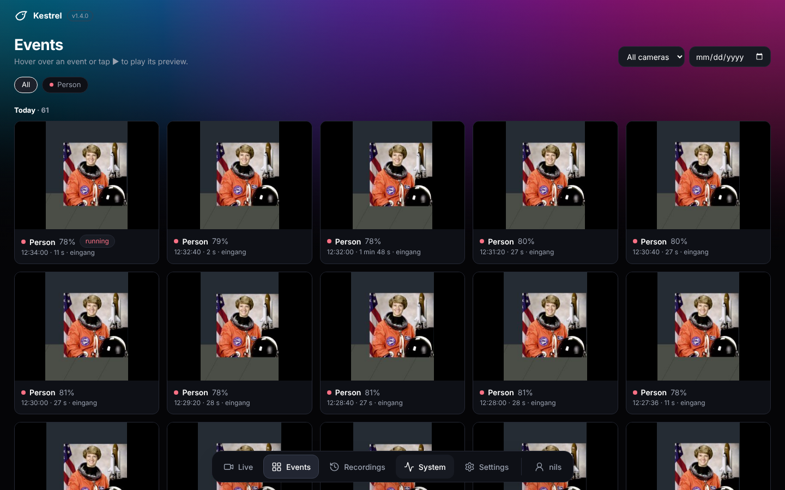
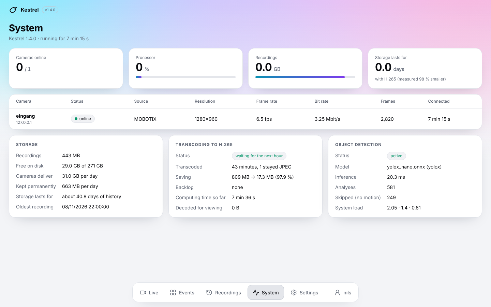
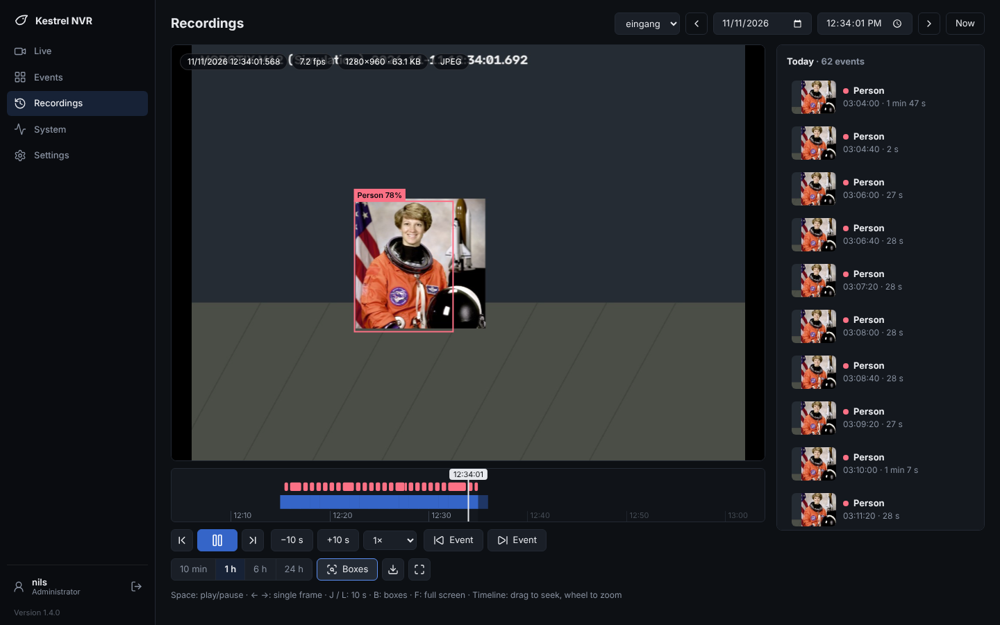
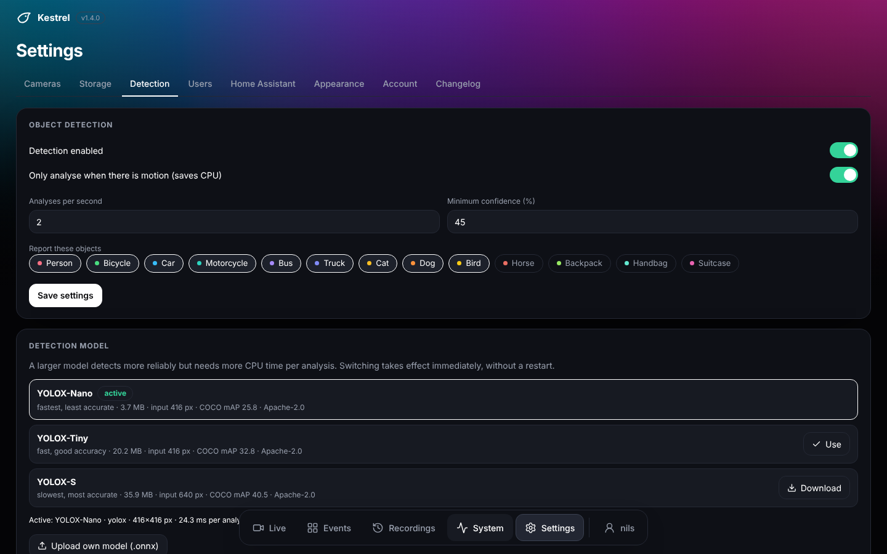
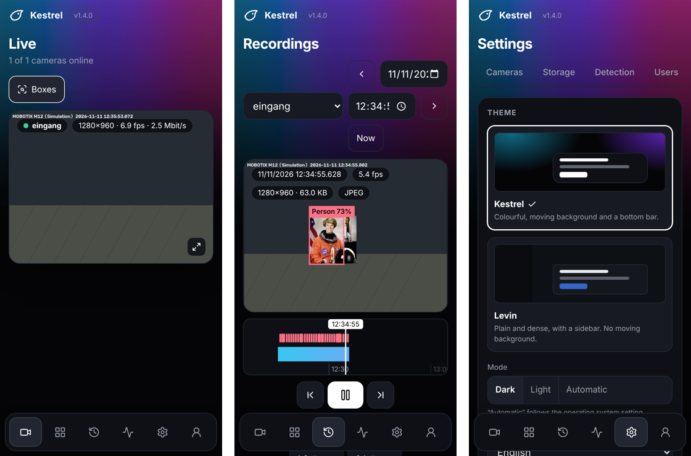

# Kestrel NVR

A lean, self-hosted network video recorder in the spirit of Frigate. It was built for the
**M-JPEG stream of MOBOTIX cameras** (M12D-Sec-DNight and every model with `faststream.jpg`) and
also records **current cameras with H.264/H.265 over RTSP** and other M-JPEG cameras. Everything
runs on the CPU – no GPU, no cloud.

*Deutsche Fassung: [README.de.md](README.de.md)*



| Recordings | Events |
|---|---|
|  |  |

| System (light mode) | Levin theme |
|---|---|
|  |  |

| Detection models | On a phone |
|---|---|
|  |  |

The screenshots show the bundled camera simulator, not a real camera.

## Features

- **Recording 24/7.** MOBOTIX/M-JPEG: every JPEG is stored unchanged with its own millisecond
  timestamp, no fixed frame rate. RTSP: the video is stored exactly as the camera sends it.
- **Player** with timeline, true variable frame rate, 0.25× to 16×, single-frame stepping, gap
  skipping, jump to next event, download of the original frame.
- **Object detection** on the CPU (YOLOX via ONNX Runtime) with tracking, events, snapshots and
  short previews. Model selectable in the UI (nano / tiny / s, or your own ONNX file).
- **H.265 in the background.** Finished hours of JPEG cameras are transcoded with the lowest
  priority; the per-frame timestamps are kept.
- **Storage guard.** Always keeps space free, deletes the oldest first and tells you how many days
  the disk will last.
- **Users and roles** (administrator, viewer), login page, session cookies.
- **Home Assistant integration** with admin approval, push events and snapshots –
  see [homeassistant/README.md](homeassistant/README.md).
- **Two themes**, each light and dark; **English and German**; installable as an app (PWA) and
  usable on a phone.
- **Simple install and update** with one script; automatic rollback if a new version does not start.

## Quick start

Requirements: a Linux host with Docker. Recordings need disk space (see *Storage format*).

```bash
unzip kestrel-nvr.zip && cd kestrel
sudo bash install.sh
```

The installer asks for IP, user and password of the first camera and for an administrator account,
builds the Docker image and starts the container `kestrel-nvr` (restarts after reboot). Then open
`http://<host-ip>:5000`.

Without a camera you can try it with the simulator:
`python3 tools/fake_mobotix.py --port 8081` (user `admin`, password `meinsm`).

## Updating

Copy the new ZIP to the host, then:

```bash
sudo kestrel update /path/to/kestrel-nvr.zip
```

(or unpack it and run `sudo bash install.sh` – an existing installation is detected.)
Configuration, users and recordings are kept; `config.yml` is backed up first. If the new version
does not start, the installer restores the previous one. Manual way back: `sudo kestrel rollback`.

More commands: `kestrel status | logs | restart | users | passwd NAME | adduser NAME [admin|viewer] | uninstall`.

The version is in `VERSION`, in the navigation and on the *System* page. Changes per version:
[CHANGELOG.md](CHANGELOG.md) and *Settings → Changelog*.

## Camera types

| Type | For | Recording |
|---|---|---|
| `mobotix` | MOBOTIX with `faststream.jpg` | Every JPEG unchanged, later transcoded to H.265 |
| `rtsp` | Current cameras (ONVIF/RTSP, H.264 or H.265) | Video as delivered by the camera – no re-encoding |
| `mjpeg` | Other cameras with M-JPEG over HTTP | like `mobotix` |

The installer sets up the first camera as MOBOTIX; add more cameras of any type under
*Settings → Cameras*.

**MOBOTIX**

```
http://<ip>/control/faststream.jpg?stream=full&needlength&fps=0
```

- `stream=full` – complete JPEG images (M-JPEG) instead of MxPEG
- `needlength` – the camera sends a `Content-Length` header per image
- `fps=0` – no limit, the camera sends as fast as it can
- HTTP Basic auth, Digest if required. Without a user the guest path `/cgi-bin/faststream.jpg` is used.
- Resolution and JPEG quality are set in the camera: *Setup Menu → General Image Settings* and
  *JPEG Settings* (switch MxPEG off there). According to the data sheet an M12 delivers about
  16 fps at VGA, 6 fps at MEGA (1280×960) and 4 fps at 3MEGA (2048×1536) with M-JPEG.
- `sensor: auto` follows the camera's day/night switching; `right`, `left` or `both` force a sensor.

**RTSP (H.264/H.265)**

- One ffmpeg process copies the stream into one-minute files without re-encoding. It decodes
  nothing and needs almost no CPU.
- A second process decodes the live picture – only while detection is on for the camera or someone
  is watching. With detection off and nobody watching, nothing is decoded.
- Every frame gets its arrival time as timestamp; player, boxes and frame stepping work as with MOBOTIX.
- For live view and detection Kestrel produces a few JPEGs per second (`live_fps`, default 5, at
  most 1920 px wide). With a low-resolution **sub stream** (`sub_url`) the main stream does not have
  to be decoded for that – this saves the most CPU, especially with 4K cameras.
- Anything ffmpeg can read is accepted (`rtsp://`, `rtsps://`, `http://`, `rtmp://`).
- Not included: ONVIF discovery, audio, pan/tilt.

## Configuration

Almost everything is set in the UI under *Settings*:

| Tab | What |
|---|---|
| Cameras | add, edit, test connection |
| Storage | retention, size limit, H.265 transcoding and its quality |
| Detection | on/off, analyses per second, minimum confidence, object classes, **model** |
| Users | accounts and roles |
| Home Assistant | connected instances, revoke access |
| Appearance | theme, light/dark, **language**, speed of the background gradient, install as app |
| Account | change password, sign out |

The settings are stored in `/config/config.yml` inside the container (see
[config.example.yml](config.example.yml)). Appearance and language are stored per browser.

### Detection models

*Settings → Detection* lists the models and downloads one on click into `/data/models`:

| Model | Input | COCO mAP | Note |
|---|---|---|---|
| YOLOX-Nano | 416 px | 25.8 | fastest |
| YOLOX-Tiny | 416 px | 32.8 | default, bundled in the image |
| YOLOX-S | 640 px | 40.5 | clearly slower |
| YOLO26n | 640 px | 40.1 | bundled; about as fast as YOLOX-Tiny, much more accurate |
| YOLO26s | 640 px | 47.8 | bundled; most accurate, about three times slower than YOLO26n |

The YOLOX files come from the release page of the YOLOX project (Megvii, Apache-2.0). The download
is checked (size, and the file must load) before it can be used. The YOLO26 files (Ultralytics,
**AGPL-3.0**) ship with the package because Ultralytics offers no ready-made ONNX downloads; see
[models/README.md](models/README.md) for how they were exported and what the license means if you
redistribute them. You can also upload your own ONNX model with the 80 COCO classes in one of three
output formats: YOLOX `[1, N, 85]`, YOLOv8/YOLO11 `[1, 84, N]` or end-to-end `[1, N, 6]` (YOLO26). Switching takes effect
immediately; the inference time of the active model is shown.

### H.265 and storage

Two minutes after every full hour Kestrel transcodes the minutes of the past hour with
ffmpeg/libx265 (`nice 19`, I/O class idle, half of the cores by default), so recording, live view
and detection keep priority.

- Every minute is verified: if the frame count of the video does not match the index exactly, the
  minute stays JPEG. The same applies to minutes in which the camera changes resolution.
- The timestamps stay in the index; frame *n* of the video belongs to timestamp *n*.
- For viewing, the required minute is decoded to `/data/cache` (pictures are usable while the
  decoding is still running, the next minute is prepared in advance) and removed after 30 minutes.
- The full value range of the JPEGs is kept (no conversion to video range and back).
- **H.265 is lossy.** After transcoding, the original JPEGs of that hour are gone. Quality: High
  (CRF 22), Balanced (26), Economy (30). Can be switched off.
- “Storage lasts for” counts fresh hours at the full camera rate and everything older with the
  measured H.265 ratio.

The storage guard checks every 10 seconds, deletes the oldest hours when space runs short, falls
back to deleting minute by minute (ring buffer) and pauses recording only if something else fills
the disk completely.

## Phone and “add to home screen”

The UI adapts to phones (touch targets of at least 44 px, dialogs as bottom sheets, landscape
player). Under *Settings → Appearance → Use like an app* there is an **Add to home screen** button.

Please note how browsers handle this:

- Chrome and Edge only offer the install dialog in a **secure context**, i.e. over HTTPS or on
  `localhost`. Over plain `http://<LAN-IP>:5000` the button is replaced by instructions; you can
  still use the browser menu → *Add to home screen*, but the page may then open with the browser
  bar, and no service worker is used.
- For the full app experience put a reverse proxy with HTTPS in front of Kestrel (Caddy, nginx,
  Traefik …) or reach it through your VPN's HTTPS feature.
- iPhone/iPad: Safari → Share → *Add to Home Screen*.

The service worker only caches the app shell (HTML, JS, CSS). Data, images, live streams and video
under `/api/` are never cached.

## Home Assistant

A custom integration is in [`homeassistant/`](homeassistant/): cameras, instantly switching
binary sensors (person, vehicle, animal, any object), a `kestrel_event` bus event for start, update
and end of every detection, an image entity with the snapshot of the last event, event entities and
system sensors. Access is approved by an administrator in Kestrel with a six-digit code; the
integration gets a read-only token. Details and an example automation with a picture:
[homeassistant/README.md](homeassistant/README.md).

MQTT is intentionally not included – see the integration README for the reasoning.

## Security notes

- Passwords: scrypt with salt. Sessions: random token in an HttpOnly cookie, only the hash is
  stored. Sessions expire after 30 days without use; changing the password signs out all devices.
- Five failed logins from one address block the login for 30 seconds, doubling up to 15 minutes.
  The limiter uses the address of the direct peer, so behind a reverse proxy all users share one
  counter.
- Viewers can see live view, recordings, events and system, but cannot change anything.
- Changing requests need a custom header (CSRF protection).
- Kestrel itself speaks plain HTTP. **Do not expose it directly to the internet.** Use a VPN, or a
  reverse proxy with HTTPS and ideally an additional authentication layer.
- The camera password is stored in clear text in `config.yml` (file mode 600) because Kestrel needs
  it to log in to the camera.

## Storage format

```
/data/recordings/<camera>/<YYYY-MM-DD>/<HH>/<MM>.idx   16 bytes per frame: time ms (u64), offset (u32), length (u32)
/data/recordings/<camera>/<YYYY-MM-DD>/<HH>/<MM>.mjr   fresh: the JPEGs of the minute, concatenated (UTC)
/data/recordings/<camera>/<YYYY-MM-DD>/<HH>/<MM>.mkv   video: transcoded (H.265) or straight from an RTSP camera
/data/recordings/<camera>/<YYYY-MM-DD>/<HH>/<MM>.skip  marker: this minute stays JPEG
/data/ingest/<camera>/                                 RTSP: segment currently being written
/data/cache/                                           minutes decoded for viewing
/data/models/                                          downloaded and uploaded detection models
/data/kestrel.db                                       events, previews, detections, users (SQLite)
```

Rough space needed before transcoding: frame size × frame rate. 1280×960 at 6 fps and 150 KB per
frame is about 75 GB per day.

## Development

Backend: Python 3.12, FastAPI/uvicorn, SQLite, ONNX Runtime, ffmpeg (`app/`).
Frontend: React 19, TypeScript, Vite (`web/`), built into `app/web/`.

```
web/src/api/           typed API client
web/src/context/       auth, preferences, toasts, dialogs
web/src/i18n/          language files and the tiny translation helper
web/src/lib/player/    playback engine (variable frame rate) and timeline
web/src/components/    ui/ (own building blocks), layout/, reactbits/ (third-party components)
web/src/features/      live, events, recordings, system, settings, auth
```

```bash
# backend against the simulator
python3 tools/fake_mobotix.py --port 8081 &
pip install -r requirements.txt
KESTREL_CONFIG=./config.yml KESTREL_DATA=./data python3 -m app.main

# frontend with hot reload (proxies /api to localhost:5000)
cd web && npm ci && npm run dev
# production build into app/web
npm run build
```

The Docker image builds the UI itself. Without access to the npm registry the installer uses the
pre-built UI shipped in `app/web` (`docker build --build-arg WEB_MODE=pre .`).

### Adding a language

1. Copy `web/src/i18n/en.ts` to `<code>.ts` (for example `fr.ts`), rename the export and translate
   the texts. Declare it as `Record<Key, string>` – TypeScript then reports every missing key.
2. Register it in `web/src/i18n/index.ts` in `CATALOGS` and `LANGUAGES` (name and locale for date
   and number formats).
3. Optional: add `CHANGELOG.<code>.md`; without it the English changelog is shown.

Keys are flat (`area.name`), placeholders are written as `{name}`. A key missing at runtime falls
back to English. The server sends error and warning **codes**; their texts are the `err.*` and
`warn.*` keys.

### Themes

All colours live in one place, `web/src/lib/theme.ts`. Another theme is another palette there.

## Not included

No audio, no MxPEG, no video export (single frames can be downloaded), no zones/masks, no MQTT.

## License

**No license has been chosen for this project yet.** Until the author adds a `LICENSE` file, no
rights to use, modify or distribute the code are granted. (Author: pick a license before
publishing – note the Commons Clause of the bundled React Bits components below when choosing.)

Third-party parts:

- The YOLOX detection models (`models/yolox_tiny.onnx` and the ones offered for download) are from
  the YOLOX project by Megvii, Apache-2.0.
- `models/yolo26n.onnx` and `models/yolo26s.onnx` are from Ultralytics, **AGPL-3.0**. Delete these
  two files if you do not want AGPL material in your distribution; see `models/README.md`.
- The components in `web/src/components/reactbits/` are from React Bits, MIT + Commons Clause; the
  license text is in that folder.
- Runtime dependencies are listed in `requirements.txt` and `web/package.json` with their own licenses.
